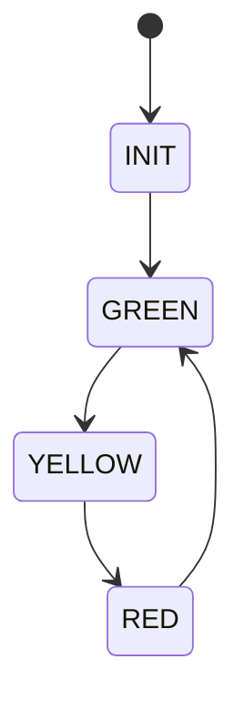

#  Verilog Traffic Light Controller

## Overview
A digital traffic light controller implemented using **Verilog HDL** and a **Finite State Machine (FSM)**. The controller cycles through initialization, green, yellow, and red states, controlling the corresponding traffic light outputs based on the current state and clock-driven transitions.

## Features
- FSM-based sequential design
- Four states: `INIT`, `GREEN`, `YELLOW`, and `RED`
- Clock-driven state transitions
- Separate outputs for red, yellow, and green lights
- Verilog testbench for functional simulation
- Simulation using **AMD Xilinx Vivado**

## State Sequence



## State Encoding

| State | Encoding |
|---|---|
| INIT | `00` |
| GREEN | `01` |
| YELLOW | `10` |
| RED | `11` |

## Hardware Outputs

| State | Red | Yellow | Green |
|---|---:|---:|---:|
| INIT | 0 | 0 | 0 |
| GREEN | 0 | 0 | 1 |
| YELLOW | 0 | 1 | 0 |
| RED | 1 | 0 | 0 |

## Tools Used
- **Language:** Verilog HDL
- **IDE:** AMD Xilinx Vivado
- **Simulation:** Behavioral Simulation

## Project Structure

```text
Verilog-Traffic-Light-Controller/
├── src/
│   └── traffic_light_controller.v
├── testbench/
│   └── traffic_light_tb.v
├── simulation/
│   └── waveform.png
└── README.md
```

## Working Principle
The controller uses a finite state machine to manage the traffic light sequence. At each clock event, the FSM transitions to the next state. The output signals are assigned according to the current state.

- **INIT:** All lights are OFF.
- **GREEN:** Green light is ON.
- **YELLOW:** Yellow light is ON.
- **RED:** Red light is ON.

The controller repeats the sequence continuously after initialization.

## Simulation
The design was verified using a Verilog testbench in AMD Xilinx Vivado.

The testbench generates the clock signal and observes the state transitions and corresponding traffic light outputs to verify the expected sequence.


## Future Improvements
- Programmable timing intervals for each light
- Pedestrian crossing control
- Emergency vehicle priority
- Countdown timer
- Reset input
- Two-road intersection control
- FPGA hardware implementation

## Author
**ECE Student**  
Digital Design | Verilog HDL

---

If you find this project useful, feel free to explore or contribute.
